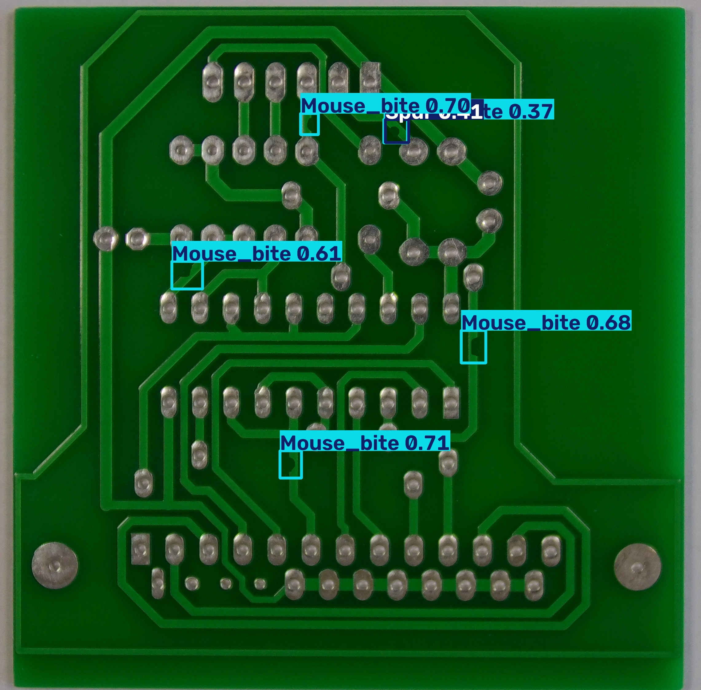

---

## Development Notes

This project is continuously improved through experiments,
documentation updates, and software development practices.

- Model evaluation and error analysis
- API and frontend improvements
- Documentation and deployment updates
<div align="center">

# PCB Defect Inspector

**Phát hiện và định vị sáu loại khuyết tật trên ảnh bo mạch in bằng YOLOv8s và YOLOv8s-P2.**

Nghiên cứu thực nghiệm trên PKU-Market-PCB · Ứng dụng minh họa với React, FastAPI và Docker

[](backend/requirements.txt)
[](frontend/package.json)
[](backend/README.md)

[Bắt đầu](#bắt-đầu) · [Kết quả nghiên cứu](#kết-quả-nghiên-cứu) · [Tài liệu](#tài-liệu-và-cấu-trúc-dự-án)

</div>

---

## Tổng quan

Ứng dụng nhận ảnh PCB, suy luận trên ảnh toàn phần và trả về **bounding box, loại lỗi, độ tin cậy** cùng kết luận ở mức ảnh. Giao diện hỗ trợ tải ảnh hoặc chụp từ webcam, so sánh ảnh gốc với ảnh đánh dấu, xem thống kê và in báo cáo.

Phần nghiên cứu so sánh hai checkpoint trên cùng bộ dữ liệu và test split đã khóa:

- **B0 — YOLOv8s:** mô hình đường cơ sở.
- **B1 — YOLOv8s-P2:** bổ sung detection head P2 để khảo sát tác động của đặc trưng độ phân giải cao.
- **B2 / Proposed:** lần lượt áp dụng ngưỡng confidence theo nhóm lớp cho B0 / B1; các ngưỡng được chọn trên validation.

> **Phạm vi:** `PASS` chỉ có nghĩa không có box nào vượt ngưỡng đã chọn; đây không phải chứng nhận bo mạch không có lỗi. Dữ liệu test không có ảnh PCB bình thường để đánh giá tỷ lệ báo động giả ở mức bo mạch.

<div align="center">
  
  <br />
  <sub>Ví dụ minh họa các vùng lỗi được phát hiện trên ảnh PCB.</sub>
</div>

## Bắt đầu

### 1. Tải mã nguồn và hai checkpoint

Checkpoint không lưu trong Git. [Release `v1.0-models`](https://github.com/TanLee261/PCB-inspection-system/releases/tag/v1.0-models) chứa B0 và B1; tải chúng về đúng đường dẫn mà backend kiểm tra SHA256:

```bash
git clone https://github.com/TanLee261/PCB-inspection-system.git
cd PCB-inspection-system

mkdir -p runs/B0_yolov8s_100ep_batch16/weights runs/B1_yolov8s_p2_100ep/weights
curl -fL https://github.com/TanLee261/PCB-inspection-system/releases/download/v1.0-models/B0_yolov8s.pt \
  -o runs/B0_yolov8s_100ep_batch16/weights/best.pt
curl -fL https://github.com/TanLee261/PCB-inspection-system/releases/download/v1.0-models/B1_yolov8s_p2.pt \
  -o runs/B1_yolov8s_p2_100ep/weights/best.pt
```

### 2. Chạy bằng Docker Compose

Cần Docker Engine/Docker Desktop đang hoạt động. Từ thư mục gốc dự án:

```bash
docker compose up --build
```

| Địa chỉ | Chức năng |
|---|---|
| <http://localhost:5173> | Giao diện kiểm tra PCB |
| <http://localhost:8000/api/model-info> | Cấu hình và trạng thái hai checkpoint |
| <http://localhost:8000/docs> | Tài liệu API tương tác |

Chọn **B0, B1, B2 hoặc Proposed** trong giao diện, tải ảnh JPG/PNG/WebP và bấm **Bắt đầu Phân tích AI**. Docker mặc định suy luận trên CPU. Dừng ứng dụng bằng `Ctrl+C` trong cửa sổ đang chạy Compose.

<details>
<summary><strong>Chạy frontend và backend riêng khi phát triển</strong></summary>

Cần Python 3.11+ và Node.js phù hợp với phiên bản Vite trong [`frontend/package.json`](frontend/package.json). Mở hai terminal:

```bash
# Terminal 1 — từ thư mục gốc
cd backend
python -m pip install -r requirements.txt
uvicorn app:app --reload --port 8000
```

```bash
# Terminal 2 — từ thư mục gốc
cd frontend
npm ci
npm run dev
```

Vite chuyển tiếp `/api` đến FastAPI. Backend mặc định dùng CPU; có thể đặt `PCB_DEVICE=mps` trên máy hỗ trợ Apple Silicon hoặc `PCB_DEVICE=0` khi có CUDA.

</details>

## Cấu hình suy luận

| Cấu hình | Checkpoint | `Open_circuit` / `Short` | Bốn lớp còn lại |
|---|---|---:|---:|
| **B0** (mặc định) | YOLOv8s | 0.25 | 0.25 |
| **B1** | YOLOv8s-P2 | 0.25 | 0.25 |
| **B2** | YOLOv8s | 0.02 | 0.58 |
| **Proposed** | YOLOv8s-P2 | 0.01 | 0.57 |

Sáu lớp được phát hiện: `Missing_hole`, `Mouse_bite`, `Open_circuit`, `Short`, `Spur`, `Spurious_copper`. Hệ thống lấy candidate với `conf=0.001`, đầu vào `1024`, NMS IoU `0.7`, sau đó áp dụng ngưỡng tương ứng. Cấu hình và hash checkpoint được khóa trong [`configs/threshold_yolov8s.yaml`](configs/threshold_yolov8s.yaml). **B1 là thay đổi kiến trúc P2, không phải tiling/SAHI.**

## Kết quả nghiên cứu

Số liệu chất lượng trên **480 ảnh test / 2.424 ground-truth box** của split đã khóa; số đo tốc độ là median xử lý toàn ảnh trên **Mac MPS**, batch 1, ba lượt đo. Hai bộ số liệu đến từ phần cứng khác nhau và được trình bày cạnh nhau để tham khảo trade-off, không phải phép đo chung trên cùng một GPU.

| Cấu hình | mAP@0.5:0.95 ↑ | F2 ↑ | Recall lỗi nhỏ ↑ | End-to-end median ↓ |
|---|---:|---:|---:|---:|
| B0 | **0.4222** | **0.8925** | **0.9548** | **85.10 ms** |
| B1 | 0.3999 | 0.8831 | 0.9289 | 99.97 ms |
| B2 | **0.4222** | 0.8486 | 0.9329 | 85.02 ms |
| Proposed | 0.3999 | 0.8449 | 0.9087 | 99.89 ms |

Trong phép đánh giá này, P2 **không cải thiện nhất quán** Recall lỗi nhỏ hoặc F2 so với B0; Proposed cũng không vượt B0 trên các chỉ số chính. Test không có ground truth thuộc bin `large`. Xem [bảng metric gốc](evaluation/B0_B1_yolov8s/week10_primary_metrics.csv), [phân tích FP/FN](evaluation/analysis/error_analysis_report.md) và [báo cáo chất lượng–tốc độ](evaluation/latency/quality_speed_report.md) để biết giao thức và giới hạn diễn giải.

## Tài liệu và cấu trúc dự án

```text
backend/       FastAPI, nạp checkpoint và lọc kết quả theo cấu hình
frontend/      React + Vite, upload/webcam, hiển thị bbox và báo cáo
configs/       Kiến trúc P2 và ngưỡng chọn trên validation
data/          Split manifest và nhãn đã chuẩn hóa; không chứa ảnh gốc
scripts/       Notebook kiểm kê dữ liệu, huấn luyện và đánh giá
evaluation/    Bảng metric, phân tích lỗi, latency và biểu đồ
experiences/   Log và artifact của các lần huấn luyện
runs/          Artifact thực nghiệm; checkpoint .pt tải từ Release
docs/          Đề cương, báo cáo kiểm kê, quyết định và roadmap
```

Ảnh PKU-Market-PCB gốc không được phân phối trong repository. Để chạy lại notebook huấn luyện/đánh giá, tải [bản dataset trên Kaggle](https://www.kaggle.com/datasets/liuxiaolong1/pcb-defect-detection-dataset), đối chiếu với [báo cáo dữ liệu](docs/01-Reports/data_audit.md) và dùng split trong `data/splits/`.

**Tài liệu tham khảo trong repo:** [backend/API](backend/README.md) · [frontend](frontend/README.md) · [chỉ mục tài liệu](docs/README.md) · [roadmap](docs/02-Thong-Ke/roadmap.md).
